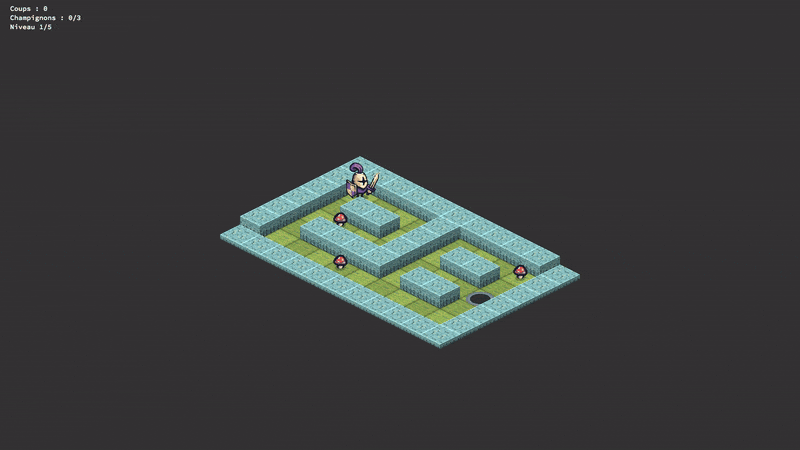

# so_long

Petit jeu 2D en **vue isométrique**, réalisé dans le cadre du cursus 42 avec la
bibliothèque graphique [MLX42](https://github.com/codam-coding-college/MLX42).

Un guerrier doit ramasser tous les champignons de la carte pour ouvrir le
portail de sortie, puis le rejoindre en un minimum de coups. Le jeu peut
enchaîner plusieurs cartes à la suite (mode campagne).

<p align="center">
  
</p>

<p align="center">
  
</p>

## Fonctionnalités

- Rendu **isométrique** : sol d'herbe, murs en blocs de pierre avec faces
  ombrées, tri en profondeur des sprites.
- **Animations** : guerrier animé (repos / course, petit saut entre deux
  cases), champignons qui flottent puis s'envolent quand on les ramasse,
  portail qui s'allume (anneau violet, colonne de lumière, étincelles) une fois
  tous les objets récupérés.
- **Caméra** qui suit le joueur en douceur sur les grandes cartes.
- **Déplacement continu** en maintenant une touche de direction.
- **HUD** : nombre de coups, champignons ramassés / total, niveau courant.
- **Écrans** de pause, fin de niveau, game over et victoire (fondu + panneau).
- **Mode campagne** : plusieurs cartes jouées l'une après l'autre.

## Dépendances

- `cc` (ou `gcc` / `clang`) et `make`
- `cmake` (≥ 3.18) pour compiler MLX42
- [GLFW](https://www.glfw.org/) (`libglfw3-dev` sous Debian/Ubuntu, `glfw` via Homebrew sous macOS)
- Bibliothèques système liées : `libdl`, `pthread`, `libm`
- Les sous-modules git :
  - `libe/libft` — [libft](https://github.com/maxg56/libft) (libft perso, avec `get_next_line` et `ft_dprintf`)
  - `libe/MLX42` — [MLX42](https://github.com/codam-coding-college/MLX42)

Sous Debian/Ubuntu :

```sh
sudo apt install build-essential cmake libglfw3-dev
```

## Compilation

```sh
git clone --recurse-submodules https://github.com/maxg56/so_long.git
cd so_long
make
```

Si le dépôt a déjà été cloné sans les sous-modules :

```sh
git submodule update --init --recursive
```

> Le sous-module MLX42 utilise une URL SSH (`git@github.com:...`). Sans clé SSH
> configurée sur GitHub, remplacez-la par l'URL HTTPS dans `.gitmodules` puis
> lancez `git submodule sync`.

Règles disponibles :

| Règle             | Effet                                                            |
|-------------------|------------------------------------------------------------------|
| `make` / `all`    | Compile libft, MLX42 puis `so_long`                              |
| `make campagne`   | Compile puis lance la campagne (`maps/campagne/*.ber`)           |
| `make clean`      | Supprime les fichiers objets                                     |
| `make fclean`     | `clean` + supprime l'exécutable et `libft.a`                     |
| `make re`         | `fclean` puis `all`                                              |
| `make fcleanall`  | Supprime aussi les bibliothèques compilées et le dossier `.tmp/` |
| `make norminette` | Vérifie la norme 42 sur les sources                              |

## Lancement

Une seule carte :

```sh
./so_long maps/p1.ber
```

Plusieurs cartes à la suite (mode campagne) — l'option `-r` doit être placée
**avant** les cartes :

```sh
./so_long -r maps/campagne/*.ber
# ou simplement
make campagne
```

La campagne fournie compte 5 niveaux de difficulté croissante :

<p align="center">
  
</p>

| Niveau | Carte                                  |
|--------|----------------------------------------|
| 1      | `maps/campagne/1_premiers_pas.ber`     |
| 2      | `maps/campagne/2_coeur.ber`            |
| 3      | `maps/campagne/3_labyrinthe.ber`       |
| 4      | `maps/campagne/4_quarante_deux.ber`    |
| 5      | `maps/campagne/5_grand_dedale.ber`     |

Autres options :

| Option | Effet                                                         |
|--------|---------------------------------------------------------------|
| `-d`   | Lance la carte par défaut (`maps/p1.ber`, cf. `config.h`)      |
| `0`    | Lit la carte sur l'entrée standard : `./so_long 0 < maps/p1.ber` |

### Contrôles

En jeu :

| Touche        | Action                     |
|---------------|----------------------------|
| `W` / `↑`     | Monter                     |
| `S` / `↓`     | Descendre                  |
| `A` / `←`     | Aller à gauche             |
| `D` / `→`     | Aller à droite             |
| `Échap`       | Pause                      |
| Fermer la fenêtre | Quitter le jeu         |

Sur les écrans de menu :

| Écran           | Touches                                                         |
|-----------------|-----------------------------------------------------------------|
| Pause           | `O` / `Y` / `Entrée` : abandonner · `N` / `Échap` : reprendre    |
| Niveau terminé  | `Entrée` / `Espace` : niveau suivant · `Échap` : pause           |
| Game over       | `R` : recommencer le niveau · `Échap` : quitter                  |
| Victoire        | `R` : recommencer toute la campagne · `Échap` : quitter          |

## Format des cartes `.ber`

Une carte est un fichier texte d'extension `.ber`, composé des caractères
suivants :

| Caractère | Signification                  |
|-----------|--------------------------------|
| `1`       | Mur                            |
| `0`       | Sol vide                       |
| `P`       | Position de départ du joueur   |
| `C`       | Objet à collecter (champignon) |
| `E`       | Sortie (portail)               |

Exemple (`maps/p1.ber`) :

```
1111111111111
10010000000C1
1C0P011111101
1C00CCE000001
1111111111111
```

Règles de validité (sinon le programme affiche `Error` suivi d'un message) :

- la carte est rectangulaire (toutes les lignes ont la même longueur) ;
- elle est entièrement entourée de murs ;
- elle contient un joueur `P`, au moins une sortie `E` et au moins un objet `C` ;
- seuls les caractères ci-dessus sont autorisés ;
- tous les objets et la sortie doivent être accessibles depuis la position du
  joueur (vérifié par un *flood fill*).

> En vue isométrique, l'axe `x` de la carte part vers le bas-droite de l'écran
> et l'axe `y` vers le bas-gauche : un dessin dans le fichier `.ber` apparaît
> tourné de 45°.

D'autres exemples se trouvent dans le dossier [`maps/`](maps/).

## Architecture du code

```
include/
├── so_long.h        prototypes et includes communs
├── game_structs.h   structures (t_game, niveaux, joueur, états…)
└── config.h         constantes réglables (voir plus bas)
src/
├── main.c           point d'entrée : options, cartes, fenêtre, boucle MLX
├── parsing/         lecture des arguments (-r, -d) et des fichiers .ber
├── map/             validation de la carte (bords, caractères, flood fill)
├── core/            fenêtre, chargement/déchargement des niveaux,
│                    enchaînement des niveaux, hooks clavier et boucle
├── iso/             projection isométrique et dessin des tuiles
│                    (sol, murs, portail) pixel par pixel
├── render/          construction de la scène du niveau et caméra
├── anim/            joueur (déplacement, animation), champignons, portail
├── ui/              HUD, panneau d'overlay et machine à états
│                    (jeu, pause, niveau terminé, game over, victoire)
└── utils/           initialisation, gestion d'erreurs, utilitaires
```

Le jeu tourne autour d'une petite machine à états (`ST_PLAY`, `ST_PAUSE`,
`ST_LEVEL_DONE`, `ST_GAME_OVER`, `ST_VICTORY`) : `loop_hook` met à jour les
animations et la caméra à chaque frame, `key_hook` route les touches selon
l'état courant.

## Configuration

Les principaux réglages se trouvent dans [`include/config.h`](include/config.h)
(recompiler avec `make` après modification) :

| Groupe          | Constantes                                         | Rôle                                         |
|-----------------|----------------------------------------------------|----------------------------------------------|
| Géométrie iso   | `TILE_W`, `TILE_H`, `WALL_H`, `LEDGE_H`, `EXIT_H`  | Taille des tuiles et hauteur des blocs (px)  |
| Fenêtre         | `WIN_MIN_W/H`, `WIN_MAX_W/H`, `HUD_H`, `MARGIN`    | Bornes de la fenêtre, hauteur du HUD         |
| Sprite joueur   | `FRAME_SZ`, `SHEET_COLS`, `ROW_IDLE`, `ROW_RUN`, `ANCHOR_X/Y`, `FRAME_TIME` | Découpage de la feuille de sprites |
| Animations      | `MOVE_TIME`, `POP_TIME`, `EXIT_FRAMES`, `EXIT_FRAME_TIME`, `FADE_TIME` | Durées (en secondes)     |
| Caméra          | `CAM_SPEED`                                        | Vitesse de suivi du joueur                   |
| Overlay         | `PANEL_W`, `PANEL_H`                               | Taille du panneau des écrans de menu         |
| Assets          | `PATH_SHEET`, `PATH_GRASS`, `PATH_STONE`, `PATH_COLLECT`, `PATH_DEFAULT_MAP` | Chemins des images et de la carte par défaut |

La taille de la fenêtre s'adapte à la plus grande carte chargée, dans les
bornes `WIN_MIN_*` / `WIN_MAX_*`.

## Crédits

- Sprites du guerrier et tuiles (`assets/img/Warrior_Purple.png`,
  `Tilemap_Flat.png`, `Tilemap_Elevation.png`) : pack
  [Tiny Swords](https://pixelfrog-assets.itch.io/tiny-swords) de Pixel Frog.
- Bibliothèque graphique : [MLX42](https://github.com/codam-coding-college/MLX42)
  par Codam Coding College.

## Auteur

[mgendrot](https://github.com/maxg56) — étudiant à 42.
