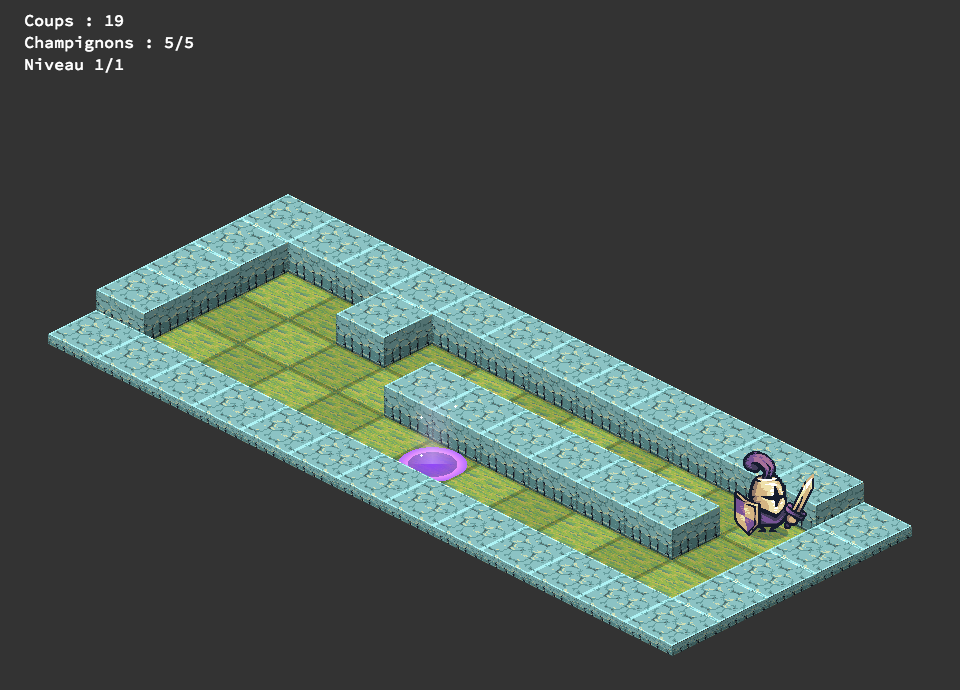
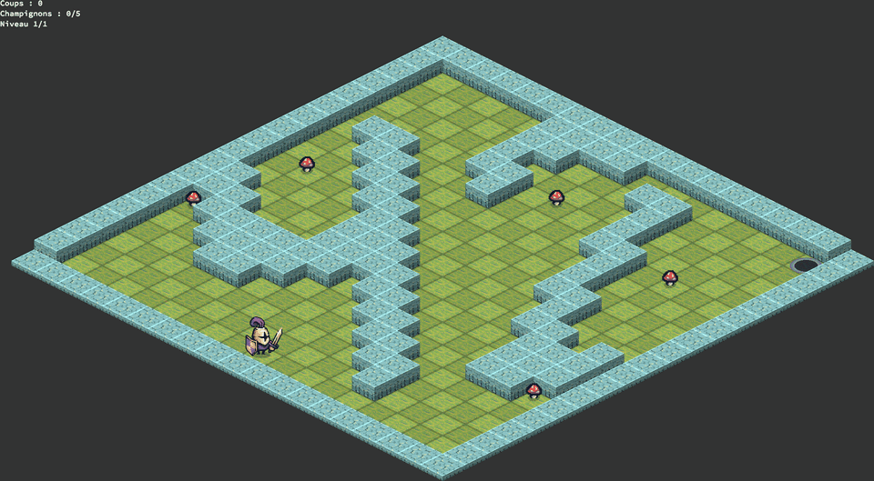
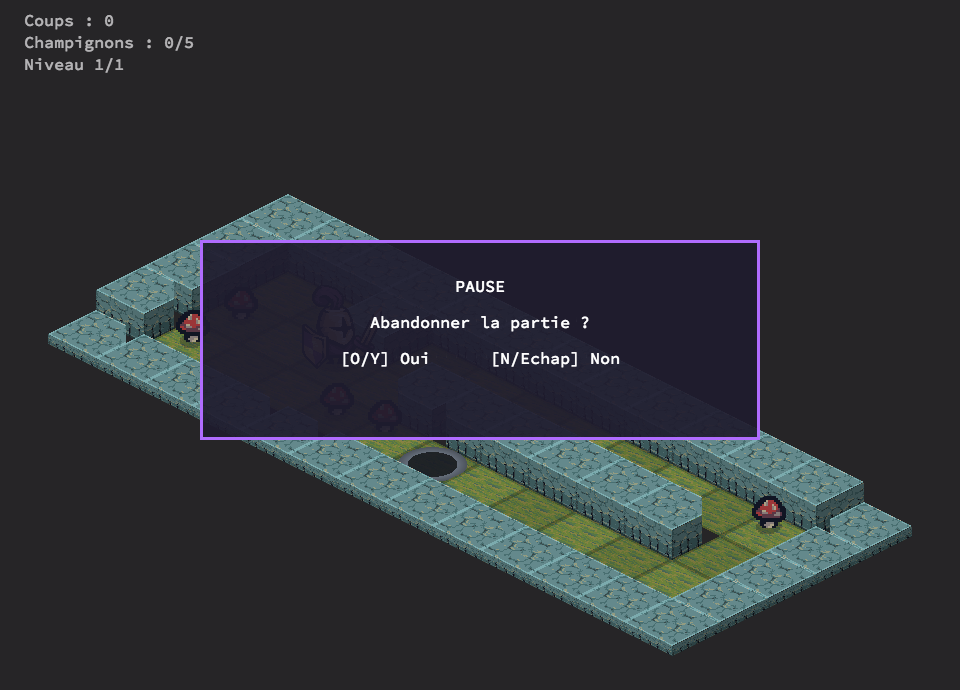

# so_long

An isometric take on the 42 `so_long` project: guide the knight through the
map, pick up every mushroom, then reach the portal. Built in C with
[MLX42](https://github.com/codam-coding-college/MLX42).



## Features

- **Isometric 3D rendering**: diamond projection with depth sorting. Floor and
  wall tiles are generated at startup from the textures in `assets/img/`. The
  front border is drawn as a low ledge so it never hides the last row.
- **Animations**:
  - the knight idles and runs, and turns to face where it walks;
  - moves slide smoothly from tile to tile with a small hop;
  - mushrooms float and fly away when collected;
  - the exit portal lights up and sparkles once every mushroom is collected.
- **Camera**: small maps are centered, and on large maps the camera follows the
  player smoothly.
- **Screens**: pause with a quit prompt, game over, level complete and victory.
  Each one fades in with a sliding panel.
- **HUD**: shows moves, mushrooms collected and the current level. Moves are
  also printed in the terminal.
- **Campaign**: 5 levels to play in a row.

| Map "42" | Pause screen |
|---|---|
|  |  |

## Build

Requirements: `cc`, `make`, `cmake`, GLFW (`libglfw3-dev` on Debian/Ubuntu)
and an OpenGL 3.3 capable driver.

```sh
git clone --recurse-submodules https://github.com/maxg56/so_long.git
cd so_long
make
```

If you already cloned without submodules, run
`git submodule update --init` before `make`.

## Run

```sh
./so_long maps/p1.ber               # one map
./so_long -r maps/p.ber maps/p1.ber  # several maps in a row
./so_long -d                        # default map (maps/p1.ber)
make campagne                       # the 5-level campaign
```

## Controls

| Key | Action |
|---|---|
| `W` `A` `S` `D` / arrows | Move (hold to keep walking) |
| `Esc` | Pause, then quit prompt |
| `Y` / `O` / `Enter` | Confirm quitting (game over) |
| `N` / `Esc` | Resume |
| `Enter` / `Space` | Next level |
| `R` | Restart (on game over or victory) |

On screen, `W` moves up-right, `S` down-left, `A` up-left and `D` down-right.

## Maps

A map is a rectangular `.ber` file:

| Char | Meaning |
|---|---|
| `1` | Wall |
| `0` | Floor |
| `P` | Player start (exactly one) |
| `E` | Exit (exactly one) |
| `C` | Mushroom to collect (at least one) |

The map must be closed by walls, and every `C` and the `E` must be reachable
from `P`.

The campaign lives in `maps/campagne/`:

| Level | Size | Style |
|---|---|---|
| `1_premiers_pas` | 11×7 | Small introductory maze |
| `2_coeur` | 17×11 | Heart-shaped room |
| `3_labyrinthe` | 17×11 | Maze, mushrooms hidden in dead ends |
| `4_quarante_deux` | 19×19 | "42" that reads upright in isometric view |
| `5_grand_dedale` | 31×17 | Large maze with loops, uses the camera |

## Project layout

```
include/
  config.h          tile sizes, timings, asset paths
  game_structs.h    game, level, player, animation structs
  so_long.h         prototypes
src/
  core/     window, level loading/restart, input and main loop hooks
  iso/      projection, pixel helpers, generated floor/wall/exit tiles
  render/   map placement and camera
  anim/     player sprite and movement, mushrooms, exit portal
  ui/       HUD, overlay panel, game states
  map/      map validation (borders, path finding)
  parsing/  arguments and .ber reading
  utils/    init, assets, errors
```

`make norminette` checks the sources against the 42 Norm.

## Credits

Character, ground and stone textures come from `assets/img/`. The mushroom
sprite is `assets/collect.png`.
