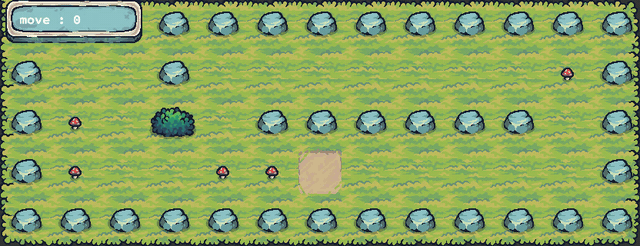
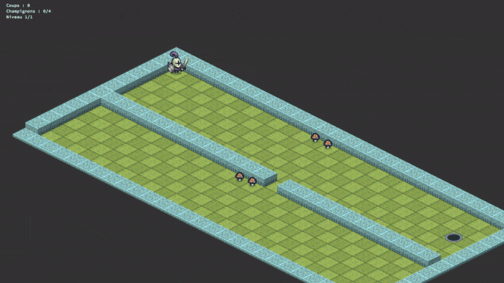

# so_long

Petit jeu 2D en vue de dessus, réalisé dans le cadre du cursus 42 avec la
bibliothèque graphique [MLX42](https://github.com/codam-coding-college/MLX42).

Le joueur doit ramasser tous les objets de la carte puis rejoindre la sortie,
en un minimum de déplacements. Le nombre de mouvements est affiché à l'écran.

<p align="center">
  
</p>

<p align="center">
  
</p>

## Dépendances

- `cc` (ou `gcc` / `clang`) et `make`
- `cmake` (≥ 3.18) pour compiler MLX42
- [GLFW](https://www.glfw.org/) (`libglfw3-dev` sous Debian/Ubuntu, `glfw` via Homebrew sous macOS)
- Bibliothèques système liées : `libdl`, `pthread`, `libm`
- Les sous-modules git :
  - `libe/libft` — [libft](https://github.com/maxg56/libft) (libft perso, avec `get_next_line` et `ft_dprintf`)
  - `libe/MLX42` — [MLX42](https://github.com/codam-coding-college/MLX42)

Sous Debian/Ubuntu :

```sh
sudo apt install build-essential cmake libglfw3-dev
```

## Compilation

```sh
git clone --recurse-submodules https://github.com/maxg56/so_long.git
cd so_long
make
```

Si le dépôt a déjà été cloné sans les sous-modules :

```sh
git submodule update --init --recursive
```

> Le sous-module MLX42 utilise une URL SSH (`git@github.com:...`). Sans clé SSH
> configurée sur GitHub, remplacez-la par l'URL HTTPS dans `.gitmodules` puis
> lancez `git submodule sync`.

Règles disponibles :

| Règle            | Effet                                                        |
|------------------|--------------------------------------------------------------|
| `make` / `all`   | Compile libft, MLX42 puis `so_long`                          |
| `make clean`     | Supprime les fichiers objets                                 |
| `make fclean`    | `clean` + supprime l'exécutable et `libft.a`                 |
| `make re`        | `fclean` puis `all`                                          |
| `make fcleanall` | Supprime aussi les bibliothèques compilées et le dossier `.tmp/` |
| `make norminette`| Vérifie la norme 42 sur les sources                          |

## Lancement

```sh
./so_long maps/p1.ber
```

### Contrôles

| Touche                   | Action            |
|--------------------------|-------------------|
| `W` / `↑`                | Monter            |
| `S` / `↓`                | Descendre         |
| `A` / `←`                | Aller à gauche    |
| `D` / `→`                | Aller à droite    |
| `Échap` / fermer fenêtre | Quitter le jeu    |

## Format des cartes `.ber`

Une carte est un fichier texte d'extension `.ber`, composé des caractères
suivants :

| Caractère | Signification |
|-----------|---------------|
| `1`       | Mur           |
| `0`       | Sol vide      |
| `P`       | Position de départ du joueur |
| `C`       | Objet à collecter |
| `E`       | Sortie        |

Exemple (`maps/p1.ber`) :

```
1111111111111
10010000000C1
1C0P011111101
1C00CCE000001
1111111111111
```

Règles de validité (sinon le programme affiche `Error` suivi d'un message) :

- la carte est rectangulaire (toutes les lignes ont la même longueur) ;
- elle est entièrement entourée de murs ;
- elle contient un joueur `P`, au moins une sortie `E` et au moins un objet `C` ;
- seuls les caractères ci-dessus sont autorisés ;
- tous les objets et la sortie doivent être accessibles depuis la position du
  joueur (vérifié par un *flood fill*).

D'autres exemples se trouvent dans le dossier [`maps/`](maps/).
